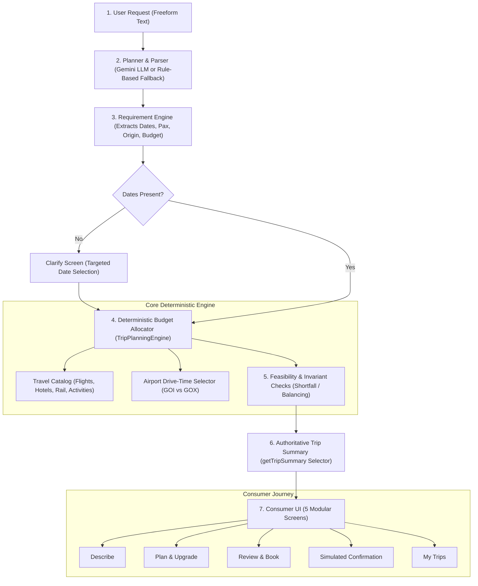

# AeroDAG — India-First Family Trip Planning Platform

AeroDAG is an AI-powered travel planning platform designed specifically for family trip planners in India. It transforms natural-language holiday requests into realistic, budget-fitted itineraries that account for family dynamics, child and senior pacing, airport ground transfer times, and domestic transit preferences. Rather than relying on generic chat responses, AeroDAG provides deterministic financial arithmetic, verified provenance tags, and concrete budget balancing options when trips exceed spending targets.

---

## Capabilities & Implementation Status

| Feature / Subsystem | Status | Details |
|---|---|---|
| **Natural Language Trip Parsing** | **Working** | Powered by Gemini (`@google/genai`) if `GEMINI_API_KEY` is provided; automatically falls back to rule-based pattern extraction with transparent notice if no key is present. |
| **Adaptive Requirement Clarification** | **Working** | Prompts for high-impact constraints (exact travel dates, child ages, walking pace) before calculating pricing. |
| **Flight Search & Selection** | **Sample data** | Catalog-based realistic sample flights with round-trip airline packaging, airport codes (e.g. BLR to GOI/GOX), and per-seat pricing. |
| **Hotel Search & Capacity Verification** | **Sample data** | Catalog-based curated hotel profiles with verified room capacities, family suitability tags, and zone-based location coordinates. |
| **Rail & Intercity Transit** | **Sample data** | Route-validated domestic train options (e.g. Yesvantpur – Vasco da Gama Express) strictly matched against active catalog route entries. |
| **Ground Transfers & Cab Excursions** | **Sample data** | Airport-to-hotel vehicle matching and local sightseeing cab costs computed only on itinerary days with planned excursions. |
| **Dining & Food Estimates** | **Sample data** | Tiered daily meal estimates (budget, mid, comfort) calculated per adult and child, with transparent downgrade rules. |
| **Deterministic Budget Allocator** | **Working** | Integer-rupee arithmetic engine with 3% (minimum ₹2,000) contingency reserve; zero floating-point drift. |
| **Airport Ground Route Optimization** | **Working** | Compares ground drive times to hotel zones (e.g. South Goa hotels route to Dabolim GOI to save 45+ minutes vs Mopa GOX). |
| **Luxury Upgrades & Balancing Options** | **Working** | Computes exact price deltas for 5-star upgrades with actionable offsets (reduce stay, switch to rail). |
| **Infeasible Budget Shortfall Handling** | **Working** | Automatically detects unachievable budgets and proposes concrete fixes (fewer nights, lower tier stay). |
| **Booking & Checkout Flow** | **Simulated** | Fully simulated sandbox checkout with idempotent submission protection; no live card charges or PNR issuance. |
| **Trip persistence** | **Working** | Supabase Postgres with RLS, falls back to this-device storage. |
| **Auth** | **Working** | Guest sessions, optional email magic link. |
| **Real Provider GDS/OTA Integration** | **Not built** | Direct API links to Amadeus/Sabre/MakeMyTrip are not connected in demo mode; all options render with honest provenance tags. |
| **Payment Gateway Integration** | **Not built** | Live UPI/Razorpay rails are intentionally omitted; demo mode simulates the confirmation flow safely. |

---

## Architecture Overview



1. **Planner & Parser**: Ingests natural language; uses Gemini if configured or instantly falls back to rule-based parsing.
2. **Requirement Engine**: Validates completeness (party makeup, budget ceiling, origin, destination). Travel dates are strictly required before pricing.
3. **Budget Allocator**: Deterministically selects matching flights, hotels, and transfers; calculates food estimates and a 3% reserved contingency buffer.
4. **Feasibility Checks**: Validates whether the plan fits the user's budget ceiling. If exceeded, flags the plan as infeasible and computes concrete fixes.
5. **Trip Summary (`getTripSummary`)**: Single authoritative source of truth for all line-items, totals, and provenance tags across the entire application.
6. **Consumer UI**: Lightweight, accessible 5-screen flow with full keyboard navigation and mobile responsiveness.

---

## How to Run

### Prerequisites
- **Node.js**: v18.0.0 or higher (v20+ recommended)
- **npm**: v9.0.0 or higher
- **Google Chrome**: Installed on host machine (required for running browser E2E tests)

### 1. Installation
Clone the repository and install dependencies:
```bash
git clone https://github.com/Aswini765/AeroDAG.git
cd AeroDAG
npm install
```
*(Dependencies install cleanly with 0 peer-dependency warnings).*

### 2. Environment Variables & Supabase Setup
Copy the example environment configuration:
```bash
cp .env.example .env
```
Key variables:
- `VITE_SUPABASE_URL`: Your Supabase project URL (e.g., `https://your-project.supabase.co`).
- `VITE_SUPABASE_PUBLISHABLE_KEY`: Browser-safe publishable key (`sb_publishable_...`).
- `GEMINI_API_KEY`: *(Optional)* Your Google Gemini API key. If omitted, AeroDAG automatically switches to deterministic basic parsing mode.
- `PORT`: Server port (default: `3000`).

#### Supabase Database & Auth Setup:
1. **Run Migration**: Execute [`supabase/migrations/0001_init.sql`](supabase/migrations/0001_init.sql) in your Supabase SQL Editor. This provisions `public.trips`, `public.bookings`, Row Level Security (RLS) policies evaluated per-query `(SELECT auth.uid())`, search-path-secured triggers, and cascading foreign keys.
2. **Enable Anonymous Sign-ins**: In your Supabase Dashboard, navigate to **Authentication** → **Sign In / Up**, scroll to **"Allow anonymous sign-ins"**, toggle it **ON**, and click **Save**.
3. **Offline Fallback**: If Supabase is unreachable or unconfigured, AeroDAG automatically falls back to versioned on-device storage (`localStorage` key `aerodag:v1:trips`) with zero PII retention.

### 3. Development Server
Start the Vite development server:
```bash
npm run dev
```
Open [http://localhost:3000](http://localhost:3000) in your browser.

### 4. Production Build & Server
Build the optimized production assets and run the Express backend:
```bash
npm run build
npm start
```
Open [http://localhost:3000](http://localhost:3000).

### 5. Running the Test Suites
- **Unit Test Suite**:
  ```bash
  npm run test:unit
  ```
  Runs 22 unit test suites (848 assertions) covering financial math, leak guards, provenance tags, date parsers, schema validation, and storage adapters.
- **Supabase Integration Test Suite**:
  ```bash
  npm run test:integration
  ```
  Verifies multi-tenant Row Level Security (RLS) isolation and idempotency across separate anonymous client sessions.
  > **Note on Test Users**: Integration tests create anonymous guest users during each run to verify cross-tenant security isolation. These anonymous test users accumulate under **Authentication → Users** in your Supabase project dashboard and can be purged periodically directly from the dashboard UI (never use or store a secret service key to delete them).
- **Real Browser E2E Test Suite**:
  ```bash
  npm run test:e2e
  ```
  Drives real headless Chrome through 5 comprehensive user journeys, axe-core WCAG accessibility audits, keyboard navigation, mobile 375px viewports, and simulated booking reload persistence (94 assertions).
- **Run All Checks**:
  ```bash
  npm run test:all
  ```
  Runs TypeScript type-checking (`tsc --noEmit`), unit test runner (848 assertions), live multi-tenant RLS integration tests, and browser E2E test suite (94 assertions).

---

## Known Limitations & What's Next

1. **Catalog Scope**: The demo catalog contains curated sample data for top family corridors (Bengaluru–Goa, Delhi–Goa, Mumbai–Goa). Expanding to additional domestic routes (e.g., Kerala, Rajasthan, Kashmir) with live NDC API feeds is the next milestone.
2. **Direct Booking API**: The current checkout executes a simulated sandbox booking (`SIMULATED BOOKING · SANDBOX`). Production deployment would connect to certified booking aggregators and IRCTC partner APIs for live ticketing.
3. **Payment Processing**: Live payments are intentionally unintegrated. Future releases will support UPI intent flows and Razorpay webhooks.

---

## Design System & Screenshots

AeroDAG uses the prototype design system:
- **Background**: `#F5F6F3`
- **Surface**: `#FFFFFF`
- **Border**: `#E2E6E1`
- **Primary Ink**: `#15201D`
- **Primary Emerald**: `#0E6B59` (Hover: `#0A5546`)
- **Typography**: Bricolage Grotesque (headings) & Figtree (UI body)

Screenshots of every stage of the user journey are available in [`docs/screenshots/`](file:///c:/Users/aswin/.antigravity-ide/AeroDAG/docs/screenshots):
- **Desktop (1440px)**:
  - [Describe Screen](file:///c:/Users/aswin/.antigravity-ide/AeroDAG/docs/screenshots/describe_1440.png)
  - [Clarify Screen](file:///c:/Users/aswin/.antigravity-ide/AeroDAG/docs/screenshots/clarify_1440.png)
  - [Plan Screen (Within Budget)](file:///c:/Users/aswin/.antigravity-ide/AeroDAG/docs/screenshots/plan_1440.png)
  - [Plan Screen (Over Budget Upgrade)](file:///c:/Users/aswin/.antigravity-ide/AeroDAG/docs/screenshots/plan_overbudget_1440.png)
  - [Plan Screen (Infeasible Shortfall Card)](file:///c:/Users/aswin/.antigravity-ide/AeroDAG/docs/screenshots/plan_infeasible_1440.png)
  - [Review & Book Screen](file:///c:/Users/aswin/.antigravity-ide/AeroDAG/docs/screenshots/review_1440.png)
  - [Done Screen (Simulated Confirmation)](file:///c:/Users/aswin/.antigravity-ide/AeroDAG/docs/screenshots/done_1440.png)
  - [My Trips Screen](file:///c:/Users/aswin/.antigravity-ide/AeroDAG/docs/screenshots/mytrips_1440.png)
- **Mobile (375px)**:
  - [Describe (375px)](file:///c:/Users/aswin/.antigravity-ide/AeroDAG/docs/screenshots/describe_375.png)
  - [Clarify (375px)](file:///c:/Users/aswin/.antigravity-ide/AeroDAG/docs/screenshots/clarify_375.png)
  - [Plan (375px)](file:///c:/Users/aswin/.antigravity-ide/AeroDAG/docs/screenshots/plan_375.png)
  - [Review (375px)](file:///c:/Users/aswin/.antigravity-ide/AeroDAG/docs/screenshots/review_375.png)
  - [Done (375px)](file:///c:/Users/aswin/.antigravity-ide/AeroDAG/docs/screenshots/done_375.png)
  - [My Trips (375px)](file:///c:/Users/aswin/.antigravity-ide/AeroDAG/docs/screenshots/mytrips_375.png)
