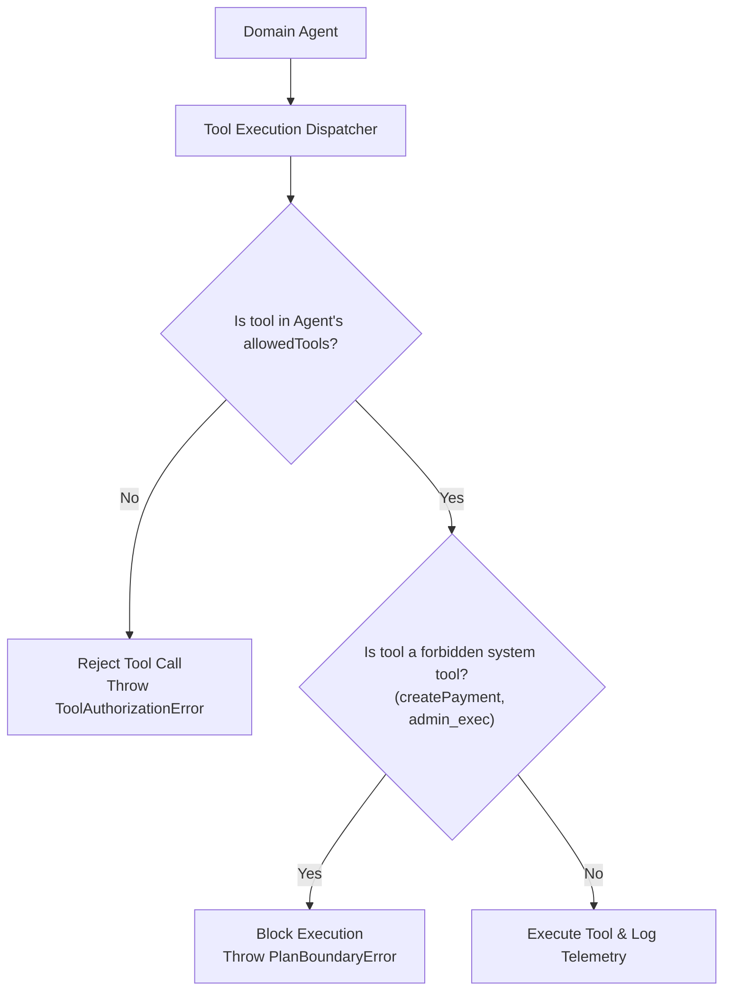

# AeroDAG — AI Engineering & LLM Architecture

This document details the AI engineering patterns, structured output schemas, agent planning algorithms, RAG grounding, evaluation frameworks, and self-correction loops implemented in AeroDAG.

---

## 1. System Prompting & Instruction Architecture

AeroDAG uses domain-isolated, structured system instructions that separate model roles from external data:

1. **Role Boundary Isolation**: Agents are defined as domain specialists (e.g. Flight Specialist, Safety Auditor) with strict behavioral boundaries.
2. **Invisible Internal Machinery**: Internal agent names, DAG dependencies, telemetry trace IDs, and raw tool schemas are never leaked to consumers.
3. **Indian Travel Domain Nuance**: System prompts encode Indian-first traveler context:
   - Domestic ID verification (Aadhaar, Voter ID) vs International passport validity.
   - Pacing requirements for multi-generational families (grandparents + young children).
   - Vegetarian / Jain / Halal dietary categorization.
   - Festive peak demand periods (Diwali, Dussehra, Christmas).

---

## 2. Structured Outputs & Schema Validation

To eliminate LLM formatting drift and JSON parsing errors, every agent output passes through a runtime schema validator:

- **Input Validation**: `validateInput(input: unknown): input is AgentInput`
- **Output Validation**: `validateOutput(output: unknown): output is AgentOutput`
- **Fallback Recovery**: If an LLM returns malformed JSON or markdown-wrapped backticks, the parser sanitizes the text and repairs structural keys before feeding downstream agents.

---

## 3. Tool Calling & Boundary Contracts

AeroDAG enforces a strict least-privilege tool execution model:

### Invariants:
- Agents can only call tools explicitly declared in their `allowedTools` tuple.
- Direct financial execution (`createPayment`, `refundPayment`) is strictly forbidden for AI agents; only backend coordinators can invoke payment providers.
- Every tool invocation logs duration, inputs, sanitized outputs, and errors to the active trace span.

---

## 4. RAG, Embeddings & Grounding Validation

The Retrieval-Augmented Generation subsystem provides verified travel regulations without model hallucinations:

1. **Document Ingestion**: Trusted embassy advisories, visa guidelines, and transit rules are ingested with freshness timestamps and authority ratings.
2. **Embedding Architecture**: Supports both `GeminiEmbeddingProvider` (cloud) and `DeterministicEmbeddingProvider` (offline/test). Cached in `SafeCacheManager` to minimize API costs.
3. **Freshness Auditing**: Documents older than 90 days trigger a `STALE_DOCUMENT` warning.
4. **Grounding Validator (`GroundingValidator`)**: Asserts that every generated answer is directly backed by source citations. Answers referencing non-existent sources or contradictory consular rules are rejected.

---

## 5. Long-Term Memory & Data Minimization

The `PersistentMemoryStore` provides user context continuity across sessions while respecting privacy:

- **Explicit User Verification**: Preferences are only stored when approved by the user (`MemoryConsentLevel`).
- **No Inferred Assumptions**: The system never stores guesses or assumptions (e.g. nationality inferred from language or IP address) as confirmed facts.
- **Privacy Sanitizer (`MemoryPrivacySanitizer`)**: Scans all memory payloads for PAN credit card numbers, CVVs, passwords, and private tokens, throwing `MemoryPrivacyViolationError`.
- **GDPR Compliance**: Full right-to-be-forgotten erasure via `purgeUserData`.

---

## 6. Dynamic Agent Planning & Cycle Detection

The `DynamicAgentPlanner` dynamically constructs tailored DAGs based on traveler goals:

- **Task Decomposition**: Breaks requests into independent and sequential tasks.
- **Cycle Detection**: Employs Depth-First Search with visited recursion stack tracking to guarantee that generated graphs are acyclic.
- **Wave Execution**: Independent discovery tasks (Flights, Hotels, Transport, Activities) run concurrently in Wave 1. Itinerary synthesis runs in Wave 2. Budget and Verification run sequentially in Waves 3 and 4.
- **Bounded Budgets**: Hard-coded limits on step count (max 20 steps) prevent infinite planning recursion.

---

## 7. Advanced AI Evaluation Framework

AeroDAG implements an evaluation framework combining deterministic evaluators and qualitative LLM judges:

### Deterministic Evaluators:
- `QuestionRelevanceEvaluator`: Verifies question appropriateness, absence of nationality inferences, and party size handling.
- `ItineraryFeasibilityEvaluator`: Asserts sequential day ordering, non-overlapping time slots, and travel duration sanity.
- `BudgetEvaluator`: Validates exact arithmetic totals without model rounding errors.
- `GroundingEvaluator`: Measures citation precision and hallucination prevention.

### Offline Resilience:
All evaluation suites operate in deterministic offline mode when Gemini API quotas are exhausted or credentials are not supplied.

---

## 8. Self-Correction & Bounded Recovery Loops

When verification audits fail, the `SelfCorrectionCoordinator` executes evidence-based recovery loops:

1. **Diagnosis**: Identifies failed constraints (e.g. `CAPACITY_BREACH`, `BUDGET_OVERAGE`, `WEATHER_PACING_RISK`).
2. **Targeted Micro-Adjustments**:
   - Hotel Capacity Breach: Automatically substitutes room/hotel tier matching party count.
   - Budget Overage: Automatically searches available catalog for value accommodation to eliminate overage.
   - Weather Risk: Reschedules outdoor excursions to clear days or indoor cultural venues.
3. **Deterministic Recalculation**: Recalculates budget after every adjustment.
4. **Strict Bounding**: Maximum 3 attempts. If constraints cannot be reconciled mathematically, the system halts and escalates transparently to the user with actionable choices.
5. **No Hallucinated Pass**: Never invents non-existent hotel inventory or fake discounted prices to force a pass.

---

## 9. Cost & Latency Optimization

1. **Model Routing**: Uses fast lightweight models for requirement extraction and high-reasoning models only for complex itinerary synthesis.
2. **Semantic Deduplication**: Identical search queries within 15 minutes are served from cache.
3. **Batch Embedding**: Vector chunks are embedded in batches to minimize HTTP overhead.
4. **Wave Parallelism**: Concurrent execution of Wave 1 tasks reduces planning latency from ~8s to ~2.5s.
