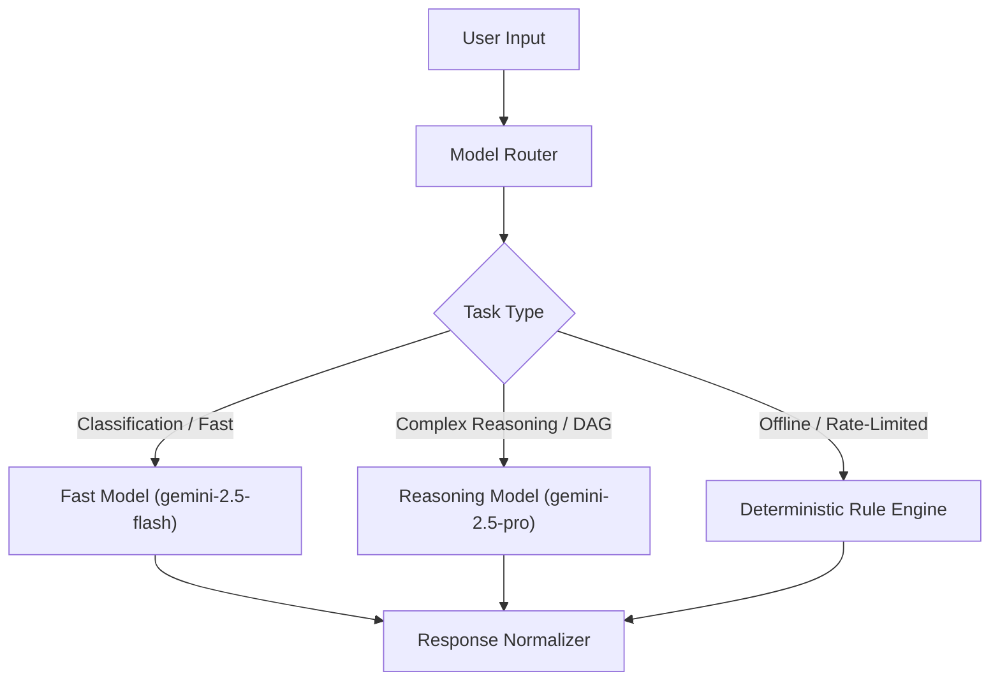
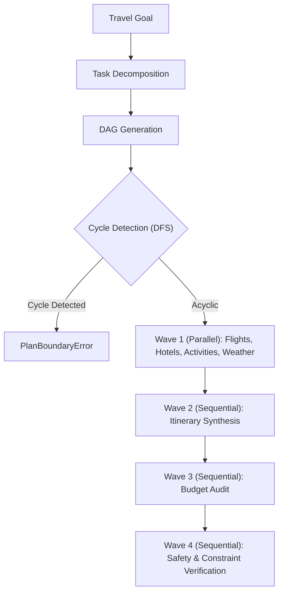

# AeroDAG — AI System Design Specification

This document provides the complete AI System Design specification for AeroDAG, detailing the model integration architecture, prompt design, structured outputs, agent orchestration, RAG grounding, persistent memory, evaluation harness, bounded self-correction, and latency/cost optimization.

---

## 1. System Philosophy & Non-Negotiable Invariants

1. **Backend Authoritative Financials**: The LLM NEVER calculates authoritative package totals, discounts, or refunds. All pricing and balances are calculated deterministically by server-side math utilities.
2. **Deterministic Fallbacks**: Every AI subsystem includes an offline, deterministic fallback engine. When external API keys are unavailable or API rate limits trigger 429 errors, the platform continues functioning without user disruption.
3. **No Unverified Claims**: The system never hallucinates flight seat availability, hotel vacancy, visa policies, or booking confirmations.
4. **Invisible Internal Machinery**: Internal agent names, DAG dependency structures, system prompts, and telemetry spans are strictly quarantined from the consumer UI.

---

## 2. Multi-Model Strategy & Provider Abstraction

AeroDAG implements a provider-neutral model layer:

- **Fast Model (`gemini-2.5-flash`)**: Used for real-time requirement extraction, conversational clarifications, post-booking Q&A, and search query reformulation.
- **Reasoning Model (`gemini-2.5-pro`)**: Used for multi-constraint task decomposition, itinerary balancing, and high-complexity travel trade-off evaluations.
- **Deterministic Consultant Engine**: Automatically kicks in whenever `GEMINI_API_KEY` is omitted or API rate limits occur, providing guaranteed uptime.

---

## 3. Adaptive Requirement Engine Architecture (Phase 9.1)

AeroDAG replaces brittle slot-filling forms with a stateful travel requirement system:

### 3.1 7-State Classification
Every trip requirement parameter is evaluated into one of seven formal states:
- `KNOWN`: Explicitly provided by the user (e.g., "Going to Goa").
- `INFERABLE`: Can be safely derived from context without risk (e.g., duration from date range).
- `OPTIONAL`: Good to have, but planning can proceed without it (e.g., preferred airline).
- `REQUIRED`: Essential for any plan (e.g., destination, dates, adults count).
- `CONTEXTUALLY_REQUIRED`: Triggered by other parameters (e.g., child ages when children > 0; passport nationality when traveling internationally).
- `UNKNOWN`: Not yet mentioned.
- `VERIFIED`: Confirmed by user after an adaptive suggestion.

### 3.2 Anti-Inferral Guarantee
- **Invariant**: The system **never infers nationality from a user's name, language, currency, or IP address**.
- For international trips, passport nationality is explicitly asked and marked `CONTEXTUALLY_REQUIRED`.
- For domestic trips, nationality is marked `KNOWN` (domestic traveler) without bothering the user.

---

## 4. Dynamic Agent Planning & Wave Execution (Phase 9.2)

Instead of hardcoded static pipelines, the orchestrator dynamically decomposes goals into a Directed Acyclic Graph (DAG):

- **Cycle Detection**: Depth-First Search with recursion stack tracking prevents circular dependencies.
- **Step Limit Enforcement**: A hard ceiling of 20 steps prevents unbounded agent execution.
- **Least Privilege Tool Boundaries**: AI agents are strictly prevented from executing financial mutations (`createPayment`, `refundPayment`).

---

## 5. Privacy-Conscious Long-Term Memory (Phase 9.3)

AeroDAG provides persistent traveler memory with strict data minimization:

- **Isolated Storage**: Partitioned by `tenantId` and `userId`. Bob cannot read Alice's past trips or preferences.
- **Privacy Sanitizer (`MemoryPrivacySanitizer`)**: Scans all memories using regular expressions for:
  - Credit Card Primary Account Numbers (PAN)
  - Card Verification Values (CVV)
  - Passwords and Private API Keys
  Violations throw `MemoryPrivacyViolationError` and are rejected before persistence.
- **GDPR Compliance**: `purgeUserData(userId, tenantId)` wipes all stored preferences, trip histories, and associated memories.

---

## 6. Advanced Evaluation Framework (Phase 9.4)

The evaluation harness operates continuously to prevent regressions:

- **Golden Dataset V2**: Multi-city journeys, domestic family trips, luxury splurges, and budget backpacker scenarios.
- **Deterministic Evaluators**:
  - `QuestionRelevanceEvaluator`: Flags redundant questions about already known fields.
  - `ItineraryFeasibilityEvaluator`: Asserts day continuity and pacing.
  - `BudgetEvaluator`: Compares aggregate costs against target ceilings without rounding errors.
  - `BookingStateEvaluator`: Detects false booking confirmation claims.
  - `GroundingEvaluator`: Ensures RAG responses reference official authority sources.
- **Regression Comparator**: Compares candidate test runs against baseline golden runs and flags regressions.

---

## 7. Bounded Self-Correction & Recovery (Phase 9.5)

When verification fails, AeroDAG triggers an evidence-based self-correction loop:

1. **Constraint Diagnosis**: Identifies whether the failure is a room capacity mismatch, budget overage, or scheduling conflict.
2. **Targeted Re-planning**:
   - *Capacity Mismatch*: Replaces standard hotel room with a family suite or connecting rooms that accommodate the full party.
   - *Budget Overage*: Replaces luxury accommodations with value accommodations from catalog inventory.
3. **Bounded Iteration**: Strict maximum of 3 attempts.
4. **Honest Escalation**: If constraints cannot be mathematically reconciled (e.g., flight alone exceeds total budget), the system halts and escalates to the user explaining the exact trade-off rather than hallucinating lower prices.

---

## 8. Latency, Cost & Quota Optimization

- **SafeCacheManager**: Caches immutable travel knowledge, flight schedules, and weather forecasts with TTLs. Booking and payment states are strictly excluded from cache.
- **Semantic Deduplication**: Normalizes prompts before dispatching to eliminate redundant duplicate LLM calls.
- **Offline Fallback Resilience**: Zero hard crashes when Gemini quotas are exceeded.
