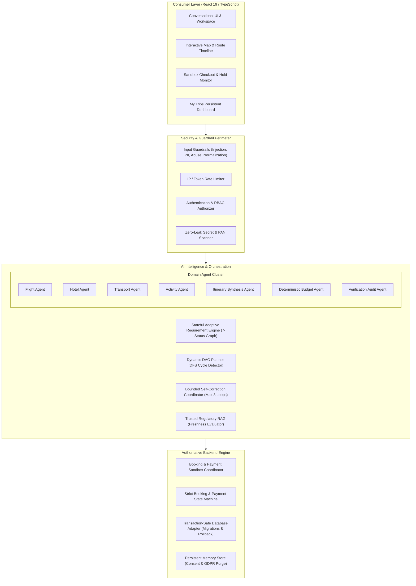
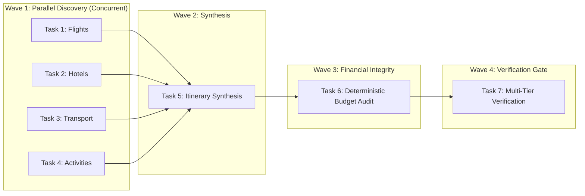
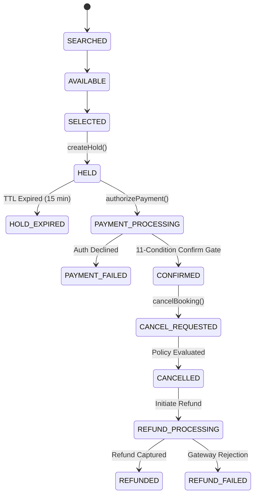

# AeroDAG — System Architecture & Technical Specifications

This document details the multi-agent system architecture, DAG planning algorithms, provider abstractions, state machines, and isolation boundaries of the AeroDAG platform.

---

## 1. High-Level System Architecture

AeroDAG couples consumer-facing interaction with an asynchronous multi-agent coordination layer and an authoritative backend booking engine:

---

## 2. Multi-Agent Responsibilities & Capabilities

AeroDAG divides domain knowledge into isolated agent workers governed by least-privilege tool allowlists:

| Agent | Responsibility | Allowed Tools | Critical Dependency |
|---|---|---|---|
| **Flight Agent** | Discover origin-to-destination flight options, calculate party totals, enforce cabin class | `searchFlights`, `lookupAirports` | Origin, Destination, Dates |
| **Hotel Agent** | Discover accommodations matching party count, evaluate room capacity, cancellation policy | `searchHotels`, `verifyHotelCapacity` | Destination, Dates, Party Size |
| **Transport Agent** | Discover intercity trains (Vande Bharat) and airport transfers (private cab/minivan) | `searchTransfers`, `searchTrains` | Origin, Destination, Stays |
| **Activity Agent** | Discover cultural, adventure, dining, and child-friendly activities | `searchActivities` | Destination, Traveller Demographics |
| **Itinerary Agent** | Synthesize morning/afternoon/evening slots into sequential non-overlapping day plans | `synthesizeItinerary` | Flights, Hotels, Activities, Transfers |
| **Budget Agent** | Perform deterministic financial arithmetic without LLM guesswork | `calculateBudgetTotal`, `auditDiscrepancy` | Assembled Itinerary & Selected Options |
| **Verification Agent** | Multi-tier audit of bed capacity, destination alignment, pacing, budget compliance | `verifyTripConstraints`, `auditRegulatory` | Complete Assembled Plan |

---

## 3. Dynamic DAG Planning & Wave Execution

Rather than relying on static pipelines, the **DynamicAgentPlanner** decomposes goals into tailored Directed Acyclic Graphs:

### Key Execution Invariants:
1. **DFS Cycle Detection**: Every generated DAG is validated via Depth-First Search with recursion stack tracking. Any cyclic dependency immediately throws a `PlanCycleError`.
2. **Step Budget Boundaries**: Plans exceeding 20 steps or requesting privileged system tools (`createPayment`, `refundPayment`, `admin_exec`) throw a `PlanBoundaryError`.
3. **Cancellation Propagation**: If a critical discovery task fails (e.g. no valid flight), downstream synthesis tasks are immediately cancelled (`CANCELLED` status).
4. **Deterministic Fallback**: If dynamic orchestration encounters provider timeouts or model rate limits, the system safely activates deterministic catalog bundles.

---

## 4. Provider Abstraction Architecture

The provider layer decouples agent logic from third-party vendor APIs, protocols, and authentication schemes:

- **MapProvider (`RealMapProvider`)**: Integrates OpenStreetMap / Nominatim geocoding and OSRM (Project Open Source Routing Machine) routing. Resolves driving distances, duration minutes, and waypoints.
- **FlightProvider (`MockFlightBookingProvider`)**: Provides deterministic seat availability, inventory holds, and confirmation voucher issuance.
- **HotelProvider (`MockHotelBookingProvider`)**: Manages room inventory, party capacity enforcement, and check-in confirmation.
- **PaymentProvider (`MockPaymentProvider`)**: Implements two-phase payments (Authorize -> Capture) with strict idempotency and refund support.
- **TravelKnowledgeProvider (`RealTravelKnowledgeProvider`)**: Supplies trusted consular, visa, and entry regulation documents.

---

## 5. RAG & Trusted Travel Knowledge

AeroDAG implements an audited Retrieval-Augmented Generation subsystem:
- **Chunking**: Heading-aware and sliding-window chunking (`DocumentChunker`).
- **Vector Search**: Cosine similarity in-memory vector store with configurable top-k and threshold filtering.
- **Freshness Evaluator**: Regulatory documents older than 90 days are flagged as `STALE` and trigger embassy verification alerts.
- **RAG Injection Defense (`RagInjectionDefense`)**: Scans all retrieved knowledge passages for prompt injection markers (`ignore all instructions`, `override permissions`) and neutralizes them before prompt assembly.

---

## 6. Authoritative State Machines

### Booking State Machine

### The 11-Condition Booking Confirmation Gate:
1. Target booking exists in coordinator registry.
2. User ownership matches booking owner (`userId`).
3. Current state is `PAYMENT_PROCESSING`.
4. Inventory hold exists and status is `HOLD_ACTIVE`.
5. Hold has not expired (`Date.now() <= hold.expiresAtMs`).
6. Hold inventory ID matches booking inventory ID.
7. Payment authorization exists, status is `AUTHORIZED`, and not previously used.
8. Authorized amount matches exact server booking amount.
9. Authorized currency matches booking currency.
10. Hotel room capacity accommodates guest party size.
11. Provider confirmation succeeds or compensation rollback refund is captured.

---

## 7. Security & Tenant Isolation Boundaries

- **Zero Trust Client Input**: Neither user ID, role, nor booking total supplied in client request bodies is trusted.
- **Tenant Isolation**: Every database record, memory entry, and audit trail is partitioned by `tenantId`. Cross-tenant queries return `null` or throw `AuthorizationError`.
- **Zero PAN/CVV Persistence**: Memory layers and telemetry stores actively reject payment card patterns (`\b(?:\d[ -]*?){13,19}\b`) and CVV descriptors.
- **Input Guardrails**: All natural language inputs pass through normalization, oversized payload rejection, profanity/abuse blocking, and prompt injection detection before agent execution.
