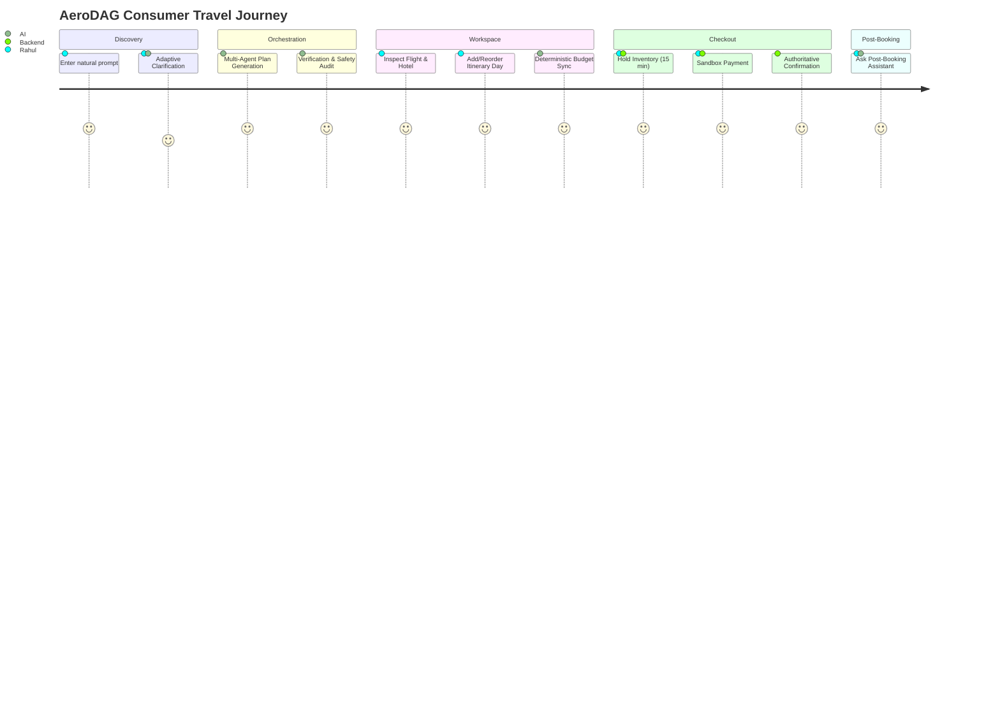

# AeroDAG — Product Case Study & Strategy

## 1. Executive Summary

AeroDAG is an AI-native travel orchestration platform tailored for the modern Indian traveler. It bridges the gap between conversational AI dream-planning and real-world execution. Unlike chatbots that produce superficial, hallucinated itineraries with invented prices and fake hotel availability, AeroDAG orchestrates multi-agent task planning, deterministic financial math, verified consular knowledge, and authoritative booking states into a seamless consumer experience.

---

## 2. The User Problem

### The Core Frustrations:
1. **Fragmented Booking Fatigue**: A typical 5-day holiday requires coordinating 6–8 disconnected tabs (MakeMyTrip, Booking.com, Google Maps, TripAdvisor, IRCTC, Visa portals). Travelers spend 12+ hours manually cross-checking hotel check-in times against flight landings.
2. **LLM Chatbot Hallucinations**: Standard AI assistants (ChatGPT, Gemini raw chat) frequently hallucinate non-existent flight routes, outdated visa regulations, unrealistic driving times (e.g., claiming a 2-hour drive between Delhi and Goa), and incorrect currency arithmetic.
3. **Absence of Indian Traveler Realities**: Existing global travel platforms fail on India-specific needs:
   - Multi-generational party pacing (accommodating elderly grandparents needing wheelchairs + energetic toddlers).
   - Strict dietary categorizations (Pure Vegetarian, Jain food, Halal options).
   - Document rules (Aadhaar / Voter ID for domestic flights vs 6-month passport validity for Southeast Asia).
   - Domestic intercity rail integration (Vande Bharat Express vs flights).

---

## 3. Target Personas & Use Cases

### Persona 1: The Multi-Generational Family Planner
- **Name**: Rahul Sharma (38, Senior Engineering Manager, Bengaluru)
- **Family**: Rahul, his wife, two children (ages 8 and 11), and elderly parents (ages 68 and 71).
- **Needs**: Connecting hotel rooms with verified 4+ bed capacity, ground-floor accessibility, low-walking heritage tours, and kid-friendly dining.
- **Pain Point**: Booking individual hotel rooms only to discover on arrival that children are separated or elderly parents must climb narrow spiral stairs.

### Persona 2: The Budget-Conscious Group Travelers
- **Name**: Ananya & Friends (College graduates, Mumbai)
- **Trip**: 4-day budget vacation to North Goa.
- **Needs**: Strict ₹35,000 total ceiling, split expenses, local scooter/cab tips, and transparent itemized pricing.
- **Pain Point**: Planning an itinerary that secretly balloons by 40% when hidden taxes and resort fees are added at checkout.

---

## 4. The 6-Stage User Journey

1. **Natural Language Inquiry**: User types: *"Plan a 5-day family trip to Vietnam for 2 adults and 2 kids under 1 lakh INR."*
2. **Adaptive Clarification**: The Requirement Engine asks only critical missing questions (child ages, passport nationality for visas), never repeating already-answered facts.
3. **Multi-Agent DAG Synthesis**: Four discovery agents run in parallel to gather real flights, stays, transfers, and activities.
4. **Interactive Workspace**: User views the day-by-day plan, reviews hotel options, edits Day 3 to add street food tours, and watches the budget automatically re-calculate with exact arithmetic.
5. **Authoritative Checkout**: User places a 15-minute inventory hold on seats and rooms, authorizes sandbox payment, and receives authoritative voucher codes.
6. **Post-Booking AI Assistant**: On departure eve, user asks *"What is planned for tomorrow?"* and receives verified schedule and transfer details.

---

## 5. Key Product Decisions & Scope Trade-Offs

### Decision 1: Invisible Multi-Agent Architecture
- **Decision**: Keep internal agents, DAG graphs, telemetry spans, and system prompts completely hidden from the consumer UI.
- **Rationale**: Everyday consumers want an intuitive, fast travel booking app (like ixigo or Airbnb), not a developer playground displaying raw JSON prompts and agent logs.
- **Implementation**: Internal telemetry and DAG observability are tucked behind a reviewer modal (`SystemObservabilityModal`).

### Decision 2: Deterministic Budget Authority Over LLM Calculations
- **Decision**: Never let the LLM calculate budget totals, currency conversions, or discount arithmetic.
- **Rationale**: LLMs are probabilistic text predictors prone to rounding errors and mathematical hallucinations.
- **Implementation**: The `BudgetAgent` and `TripWorkspaceManager` use deterministic arithmetic functions.

### Decision 3: Sandbox Coordinator Over Live Financial Charges
- **Decision**: Implement an authoritative sandbox booking coordinator rather than connecting live merchant credit card processing.
- **Rationale**: Prevents accidental financial charges during portfolio evaluation, avoids requiring live merchant banking contracts, while faithfully demonstrating complete two-phase authorization, hold expiration, compensation, and refunds.

---

## 6. Product Success Metrics & KPIs

1. **Clarification Efficiency**: Average clarification turns required before plan generation <= 2.
2. **Plan Generation Latency**: Total DAG generation duration <= 3.5 seconds via wave-based parallel discovery.
3. **Constraint Compliance Rate**: 100% adherence to room capacity and budget ceilings verified by verification audit.
4. **Checkout Conversion**: Sandbox booking hold-to-confirmation completion rate >= 85%.
5. **Zero Financial Hallucination Rate**: 0% false confirmations or hallucinated bookings.

---

## 7. Future Product Roadmap

- **Q1 2027**: Live NDC airline API integration for direct ticketing with Indian domestic carriers (IndiGo, Air India).
- **Q2 2027**: IRCTC train booking integration for seamless Vande Bharat and Tatkal ticket selection.
- **Q3 2027**: Group expense splitting with UPI deep-linking (Google Pay, PhonePe, Paytm).
- **Q4 2027**: Real-time flight delay re-accommodation and proactive push-notification re-routing.
